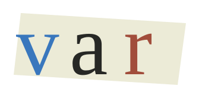

# var

Scripts, references, and local models → narrated videos on your Macs.

`studio.py` turns a scene script into voice audio, generated images, and an MP4
with gentle camera movement, fades, and captions. Regenerate individual scenes
while keeping the parts you like.

## Get started

```sh
./setup.sh media
source .venv-media/bin/activate
python studio.py init projects/my-video
```

Edit `projects/my-video/project.json` with your narration, image prompts, and
reference paths, then run:

```sh
python studio.py build projects/my-video
```

The result is `projects/my-video/final.mp4`. See [the media guide](docs.md#narrated-videos)
for your own scripts, references, and scene revisions.

## Distributed inference

`engine.py` experiments with splitting a Qwen text model across two or three
Apple silicon Macs. [Setup and commands](docs.md#distributed-text-inference).

Media generation currently runs locally per stage. You can run narration and
images on separate Macs and copy their assets together; media model weights
are not yet split across machines. Quality and throughput need hardware testing.
