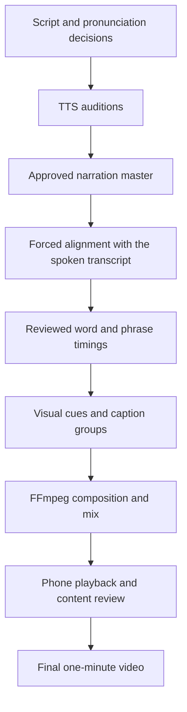

# Natural voice and smooth video: research and roadmap

Research date: **2026-11-02**. Scope: original one-minute English technology shorts,
two or three finished videos per day, with iterations, on three Apple silicon Macs
with 16 GB each and Wi-Fi. Preference: **local first, cloud services as optional
quality benchmarks**. This is research and a proposed plan, not a model bake-off
or an implementation change.

## Recommendation

**Make an approved narration master the clock for the video.** Choose a voice by
listening to complete passages, align the approved recording to its transcript,
then place visuals, captions, and edits against those timestamps.

The next milestone should be **one convincing Lisp narration and one polished
video built around it**. Compare the current Chatterbox voice with a deliberately
chosen reference, Qwen3-TTS 1.7B, and one continuation-capable candidate. Keep the
shortlist small. A different model might improve delivery, but model size alone
does not settle naturalness, pronunciation, or continuity.

## What the existing example tells us

Read-only inspection of `studio.py`, the Lisp project, generation records, and
FFprobe output found:

| Observation | Current Lisp short |
| --- | --- |
| Narration | 163 written words, 14 independent generation jobs |
| Selected model | `mlx-community/chatterbox-turbo-fp16` |
| Deliberate reference voice | None configured; checkpoint default conditioning |
| Source WAV duration | Approximately 70.65 seconds total |
| After the current edge-trim rules, before tempo changes | Approximately 67.83 seconds |
| Finished duration | 60.0 seconds |
| Sum of saved generation wall times | Approximately 77.99 seconds |
| Visuals | One image and the same centered zoom per scene, 24 fps |
| Captions | Whole-scene selectable subtitles, without word alignment |

These are **observations from saved artifacts**, not a controlled benchmark.
Exact chip, cold/warm state, competing workloads, and peak system memory were not
recorded. Summed generation time includes each invocation's work; it should not
be reported as a warm-model speed measurement for all three Macs.

Important distinctions:

- The reduction from 70.65 to 60 seconds includes silence removal. The edge-trim
  analysis suggests approximately **1.13× net tempo** would be needed after that
  trim, with rounding and time-stretch implementation affecting exact timing.
- The code applies `atempo` during audio preparation and again when fitting the
  target. At fixed duration, those changes approximately compensate: increasing
  `speech_rate` does not create a faster overall minute with the same word count.
- Fourteen visual scenes currently imply fourteen separately synthesized phrases.
  **Inference:** this coupling makes phrase-to-phrase rhythm harder to control.
  It does not prove that every model reset causes an audible defect.
- A minute containing 163 words averages 163 words/minute, regardless of the speed
  setting. Faster delivery needs a different script or a different allocation of
  pauses and visual holds.
- Final-track loudness normalization is already implemented. The larger gaps are
  performance, continuity, alignment, and editorial timing.

Local evidence: [runner](../studio.py), [Lisp generator](../examples/lisp_origin.py).
Generated project records live under `projects/lisp-origin/` and are git-ignored.

## Voice landscape

Documented model support is different from measured quality on our scripts.

| Candidate | Why audition it | Constraints and decision |
| --- | --- | --- |
| **Chatterbox Turbo FP16** | Existing baseline; English voice-reference conditioning. Test a chosen voice rather than only the checkpoint default. | Its MLX implementation ignores exaggeration, CFG, and min-p. It internally chunks longer text and clears cache between chunks; one request is not proof of a single context-continuous performance. |
| **Qwen3-TTS 1.7B CustomVoice, 8-bit** | Preset voices plus natural-language delivery instructions. Audition documented English presets Ryan and Aiden. | Reference cloning belongs to **Base**, not CustomVoice. The 0.6B CustomVoice model lacks the instruction control of 1.7B. No listening result here establishes a winner. |
| **Qwen3-TTS 1.7B Base** | A second route when a particular reference identity matters. | Requires the appropriate reference workflow, normally audio and its transcript. Reusing a reference is not the same as continuing previous generated speech. Add only if custom identity is needed. |
| **VoxCPM2, 8-bit** | Promising different approach: the pinned MLX implementation supports previous speech through `prompt_audio` and `prompt_text`, optionally with a separate reference identity. | Continuation needs a Python integration, not assumed support in our generic CLI. Test full-minute stability, pronunciation, memory, and actual joins. |
| **Sesame CSM-1B** | Context-conditioned speech through text/audio segments. | Exploratory fallback. The public base checkpoint is not the polished Sesame demo voice. It needs an appropriate context/voice setup. |

Primary sources: [MLX Turbo v0.6.3](https://github.com/Blaizzy/mlx-audio/blob/v0.6.3/mlx_audio/tts/models/chatterbox_turbo/chatterbox_turbo.py),
[Qwen documentation](https://github.com/QwenLM/Qwen3-TTS),
[VoxCPM upstream](https://github.com/OpenBMB/VoxCPM),
[VoxCPM2 MLX v0.6.3](https://github.com/Blaizzy/mlx-audio/blob/v0.6.3/mlx_audio/tts/models/voxcpm2/voxcpm2.py),
[CSM upstream](https://github.com/SesameAILabs/csm).

**Initial comparison:** current Turbo default voice; Turbo with one clean reference;
Qwen 1.7B CustomVoice. Introduce VoxCPM2 if continuation remains the limiting issue
or if the first comparison leaves no acceptable voice. Compare preset and cloned
voices as complete production choices, rather than claiming a controlled
same-speaker model ranking when the identities differ.

Storage evidence supports trying these on an otherwise idle 16 GB machine:
Qwen 1.7B 8-bit is approximately 3.08 GB of repository files, Turbo FP16 about
2.99 GB, and VoxCPM2 8-bit about 3.23 GB. **Those are downloads, not peak RAM**;
caches, vocoders, references, temporary buffers, and macOS require additional
space. Measure a complete minute before deciding fit.
[Qwen files](https://huggingface.co/mlx-community/Qwen3-TTS-12Hz-1.7B-CustomVoice-8bit/tree/main),
[Turbo files](https://huggingface.co/mlx-community/chatterbox-turbo-fp16/tree/main),
[VoxCPM2 card](https://huggingface.co/mlx-community/VoxCPM2-8bit).

Defer a broad backend collection. Fish S2 Pro has an MLX conversion but its
upstream weight license remains research/noncommercial without separate
permission. Fish Drama 3's 4-bit repository is about 23.8 GB, making it a poor
first candidate for ordinary all-resident inference on one 16 GB Mac. Neither
should displace the small shortlist solely because of impressive demos.
[S2 Pro terms](https://huggingface.co/fishaudio/s2-pro),
[Fish repository](https://github.com/fishaudio/fish-speech),
[Drama 3 files](https://huggingface.co/mlx-community/fish-audio-drama-3-4bit/tree/main).

## Voice reference, direction, and continuity

Use a clean recording of the intended voice, with the desired level of energy,
clear pronunciation, and little background sound. Start around ten seconds and
follow the chosen backend's requirements. A reference is a hypothesis to test,
not a guarantee that the model inherits its exact rhythm. Preserve the reference,
transcript where needed, checksum, and delivery brief with each take.

Distinguish three workflows:

1. **Reference TTS:** a sample anchors the voice; the model performs new words.
2. **Speech continuation:** previous words/audio condition subsequent generation.
3. **Performance conversion:** a recording already contains the target words and
   delivery, and another system changes the voice. This adds a recording step.

For narration generation, compare the same script as a whole take, two to four
meaning-based blocks, and the current scene fragments. Approve whichever survives
listening and repair tests. A larger input can still be internally chunked or
produce drift; a shared voice sample does not establish shared prosodic context.

Edit failed phrases with their neighboring context. Prefer a pause or breath for
the splice. A small fade can remove a click; it does not repair a mismatched
intonation contour. Keep the last approved master and all candidate takes.

## Proposed speech-led architecture

Minimal proposed artifacts: `script.txt`, `narration/master.wav`, `alignment.json`,
`timeline.json`, and `final.mp4`. These paths describe a future mode, not commands
that already exist. Visual changes should reuse the approved audio and alignment.
Changing a shot should not require synthesizing a new sentence.

**Alignment candidate:** Qwen3-ForcedAligner 0.6B 8-bit is already documented in
the project's pinned MLX Audio release. It takes known audio, text, and language
and returns word boundaries. The installed package contains its implementation;
an import/dependency and accuracy smoke test is still required on a GPU-capable
session. Start there before adding another alignment framework.
[Pinned MLX usage](https://raw.githubusercontent.com/Blaizzy/mlx-audio/v0.6.3/mlx_audio/stt/models/qwen3_asr/README.md),
[Qwen aligner upstream](https://github.com/QwenLM/Qwen3-ASR).

WhisperX and Montreal Forced Aligner are fallbacks. The former documents CPU/int8
use on macOS and limitations for some dictionary-unsupported tokens; the latter
offers explicit pronunciation dictionaries. An aligner timestamps expected words;
it cannot certify that the speaker pronounced them correctly.
[WhisperX](https://github.com/m-bain/whisperX),
[MFA alignment evaluation](https://montreal-forced-aligner.readthedocs.io/en/latest/user_guide/implementations/alignment_evaluation.html).

Maintain canonical visible text and the actual spoken form. For example, captions
can retain `1958`, `MIT`, and `eval` while synthesis uses the intended expansions.
Review the mapping rather than replacing caption spelling with phonetics. SSML
and phoneme markup should be used only when the selected backend supports them.

## What makes the picture feel smooth

These are **editorial proposals**, to validate in one complete pilot:

- Design each beat around an explanation, result, or joke. Use asymmetric holds:
  enough time to read code, quicker reaction shots, and a clear ending.
- Reveal a code line when the narrator refers to it; show the result when the
  result is spoken. Carry the audio across a cut when the thought continues.
- Replace repeated centered zooms with a few purposeful patterns: code/output,
  evolving diagram, comparison, timeline, and occasional visual punchline.
- Use crisp supplied graphics or recorded interfaces for technical evidence.
  Generative illustrations can support metaphors; important code should remain
  real, readable text.
- Use short phrase captions and selective emphasis. Keep code and captions from
  competing for the same space, and review on a phone.
- Approve dry narration first. Add restrained music and motivated effects later,
  ducking the bed beneath speech. Keep the existing -16 LUFS / -1.5 dBTP targets
  as house settings and measure the final encoded output.

**Frame rate:** 60 fps can help a specific fast move, but changing the current
24 fps still-image sequence to 60 does not supply better choreography. Compare
30 and 60 on a representative cursor/pan/diagram before choosing a template.
YouTube supports common frame rates and recommends preserving captured rate.
[YouTube encoding guidance](https://support.google.com/youtube/answer/1722171).

**Rendering choice:** reuse FFmpeg for the first pilot. Its filters cover overlays,
tempo, loudness measurement, and sidechain compression. The installed build
exposes overlay/zoom/ducking but does **not** list `subtitles`, `ass`, or `drawtext`.
For baked captions, either select a libass-enabled build or reuse the installed
Pillow approach to render timed caption overlays. Do not assume soft subtitles
will appear after a social-platform upload.
[FFmpeg filter source](https://raw.githubusercontent.com/FFmpeg/FFmpeg/master/doc/filters.texi).

Consider Remotion only if reusable animated code/UI and interactive preview become
awkward with the simple cue renderer. Consider Manim for structurally changing
math/algorithm diagrams. Neither is the next fix for voice delivery.
[Remotion](https://www.remotion.dev/docs/idea),
[Manim](https://docs.manim.community/en/stable/reference/manim.animation.transform_matching_parts.TransformMatchingShapes.html).

## A small evaluation that can choose a voice

Short clips are a cheap shortlist, not proof of sustained quality. Research on
long-form TTS found that sentence and paragraph ratings need not agree.
[Clark et al., Evaluating Long-form TTS](https://storage.googleapis.com/gweb-research2023-media/pubtools/5234.pdf).

1. Freeze a roughly 15-second difficult passage covering Lisp, John McCarthy,
   1958, `eval`, and an acronym. Define intended pronunciations beforehand.
2. Generate three takes per candidate, keeping failures. Use native pace first.
   Record the backend, reference, settings/defaults, script revision, wall time,
   audio duration, and machine. Match measured loudness, hide model labels, and
   randomize presentation order.
3. Have two or three listeners rank naturalness, intention/emphasis, pronunciation,
   and consistency, with timestamped reasons. An optional human reading provides
   a performance anchor. A small internal panel is not a publishable MOS study.
4. Test the best two on a complete minute, a holdout script, and a replaced
   paragraph. Listen without music, then inspect every join with surrounding
   context. Evaluate the finished processing/encoding, not only raw model output.
5. Release only when the full take is convincing and the visuals follow its
   rhythm. A proposed internal gate is at least 4/5 for delivery and continuity,
   with **zero critical content errors, clipped words, loops, or obvious glitches**.

ASR diffs can flag missing/repeated words; speaker embeddings can flag identity
outliers. Neither measures natural delivery adequately. Embedding research shows
rhythm and processing confounds; a forced alignment is not a separate transcript
verification. Keep human listening as the deciding test.
[Subjective test guidance](https://www.itu.int/rec/T-REC-P.808-202106-I/en),
[speaker-similarity limitations](https://www.isca-archive.org/ssw_2025/carbonneau25_ssw.pdf).

## Optional cloud quality benchmarks

Use the same script and delivery intent, if a paid audition is later chosen.
No inference requests, uploads, or purchases were made in this research.

- **ElevenLabs:** compare a current expressive model with its stable long-form
  option. Current docs describe Eleven v4, v3, and Multilingual v2; those are
  vendor capability claims, not a listening result here.
  [Official model overview](https://elevenlabs.io/docs/overview/models).
- **OpenAI:** verify the currently supported speech workflow at test time. Its
  official schedule deprecates `tts-1`, `tts-1-hd`, and `gpt-4o-mini-tts`, with
  shutdown on January 6, 2027 and a Realtime replacement. A future benchmark
  should not assume an older TTS tutorial is a durable integration.
  [Official deprecation schedule](https://developers.openai.com/api/docs/deprecations).
- **Recorded-performance benchmark:** ElevenLabs Voice Changer documents retaining
  the source performance's delivery. This can help distinguish voice timbre from
  performance direction, but is a separate route from reference TTS and entails
  recording/uploading the intended words.
  [Voice Changer documentation](https://elevenlabs.io/docs/eleven-creative/playground/voice-changer).

Compare complete outputs rather than promising that a hosted model beats a local
model. Prices, account access, output terms, and paid throughput remain unchecked.

## Use the three Macs productively

Start with independent work: voice takes/alignment on one Mac, image/graphic work
on another, and encoding or a second candidate on the third. Load models
sequentially within each 16 GB budget until profiling supports concurrency.
Transfer scripts and finished assets over Wi-Fi. Investigate weight sharding only
after a winning model exceeds a machine's practical memory and its implementation
supports the required distribution.
[MLX distributed execution](https://github.com/ml-explore/mlx/blob/main/docs/src/usage/distributed.rst).

Capacity must include retries and review. For three videos with three full-minute
takes each, budget nine minutes of generated speech, plus repairs. With six visual
scenes and two image candidates per scene, budget 36 image generations. Multiply
those workloads by measured per-Mac times; add encoding, transfers, and editing.
The current 78-second Lisp log would imply about twelve minutes for nine similar
narration jobs, **only as an illustrative same-workload calculation**, excluding
other stages and without a speed guarantee for a different model or Mac.

Benchmark one cold and three warm runs of both short and full-minute scripts on
each actual chip. Record process/system memory pressure as well as MLX allocation,
swap, errors, and accepted-take rate. Finish three complete shorts and record
human editing time before claiming the two-to-three-per-day target is met.

## Implementation order and completion gates

| Order | Smallest complete change | Gate |
| --- | --- | --- |
| 1 | Controlled voice audition pack using existing takes plus Qwen 1.7B; add VoxCPM2 only for the continuation experiment. | A complete narration and repair pass the listening/content checks. |
| 2 | Narration-master mode, separate from visual scene definitions. Compare full takes and coherent blocks. | A visual edit leaves approved speech unchanged; failed audio can be repaired without an obvious seam. |
| 3 | MLX forced alignment and reviewed phrase timings. | Technical names and boundaries checked; edited audio invalidates old alignment. |
| 4 | Small cue timeline: code reveals, diagrams, purposeful cuts, baked phrase captions. | One coherent one-minute Lisp pilot passes phone playback review. |
| 5 | Repeatable styles, accepted-take records, and independent workers. | Three finished shorts establish actual time, memory, and revision costs. |

Do not start with a universal video editor, every voice backend, fine-tuning, or
multi-Mac TTS weight sharding. Revisit those when the approved pilot or measured
constraints make them necessary.

## Limits of this research

No new model was generated or auditioned, no aligner was run, and no cloud service
was called. Model continuation, peak RAM, technical pronunciation, and subjective
quality need the controlled trials above. Proposed thresholds and editorial
patterns are project decisions, not guarantees from the cited papers. Exact
chips and desired reference voice remain unspecified.
